# Sakila DVD Rental Store: Business Intelligence Dashboard

An end-to-end analysis of the Sakila DVD rental database using **SQL**, **Excel** and **Power BI**.
It turns rental, customer, film, store and staff data into one connected view of the business,
then into recommendations.

**Tools:** MySQL · Excel · Power BI (DAX, data modeling)

## Approach

1. **Framed the questions** with a MECE breakdown ([MECE.docx](MECE.docx)).
2. **Explored the data in SQL**: [sakila_eda.sql](sakila_eda.sql) answers 15 business questions.
3. **Explored the data in Excel** ([EDA.xlsx](EDA.xlsx)).
4. **Modeled the 16-table schema in Power BI** and built a 6-page dashboard ([SAKILA_DASHBOARD.pbix](SAKILA_DASHBOARD.pbix)).
5. **Presented the insights** in the deck below ([Sakila_PowerBI_Analytics_1.pptx](Sakila_PowerBI_Analytics_1.pptx)).

## Presentation

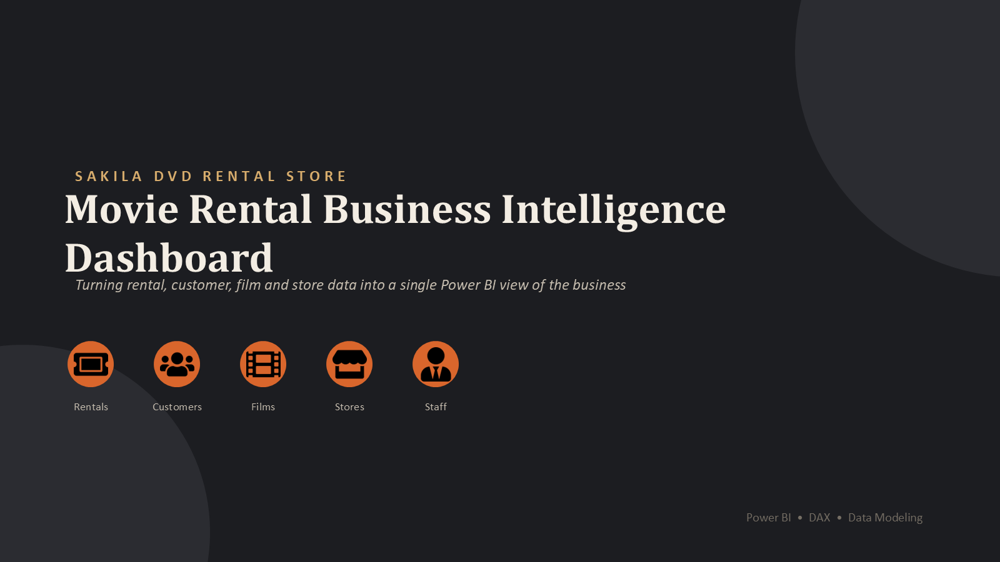
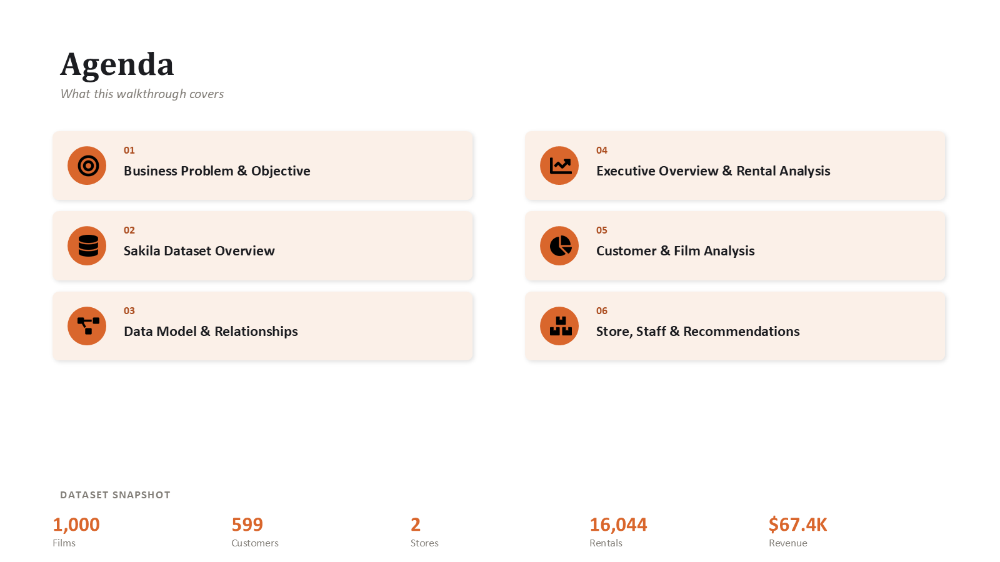
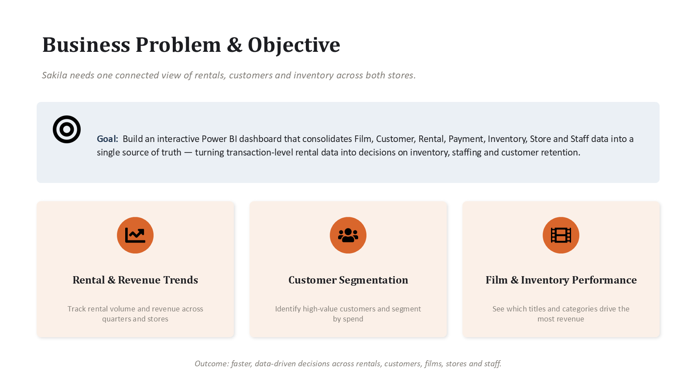
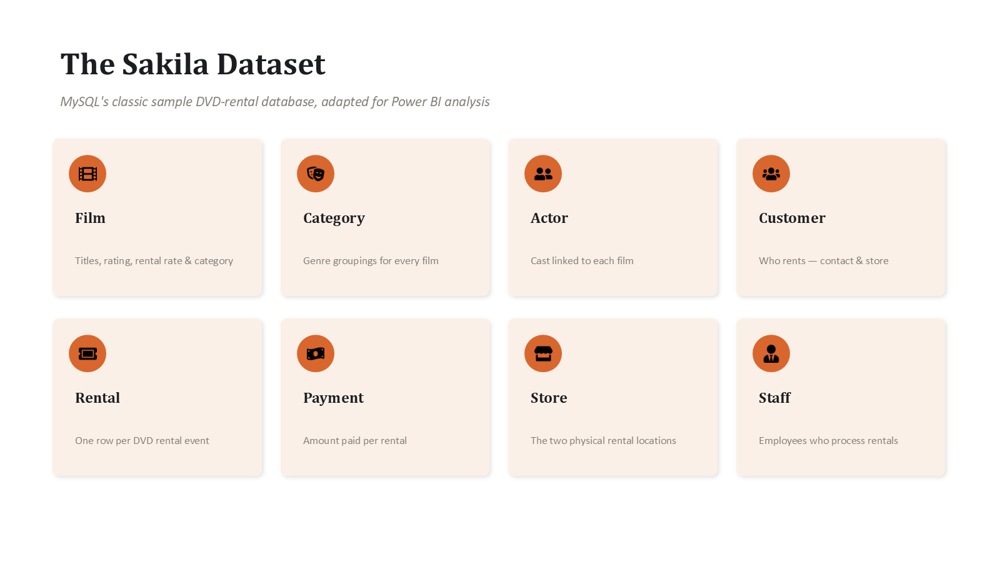
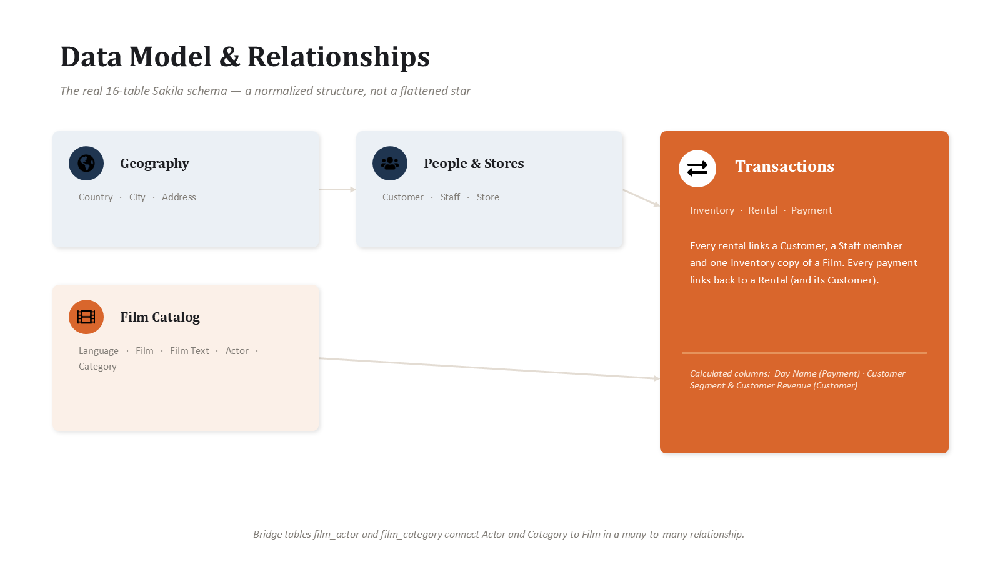
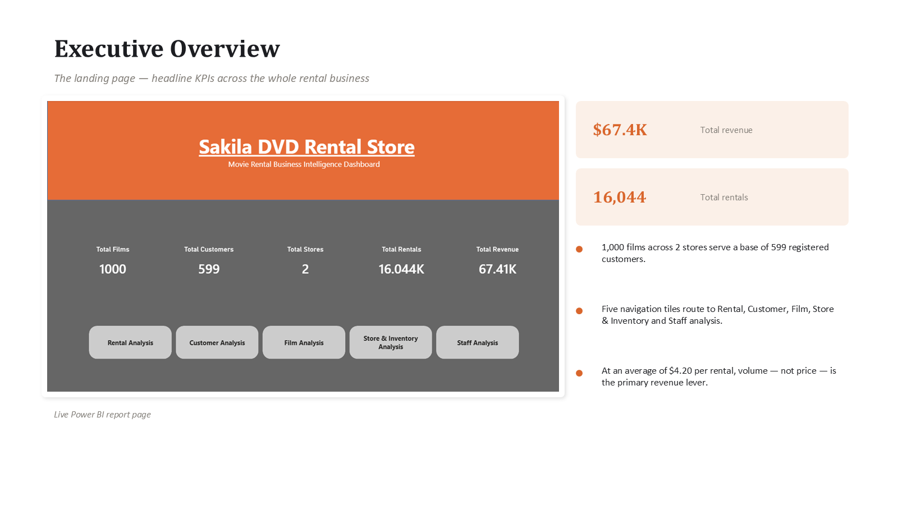
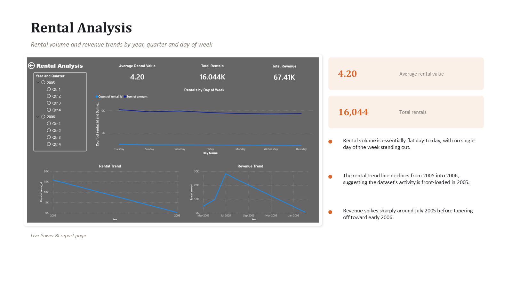
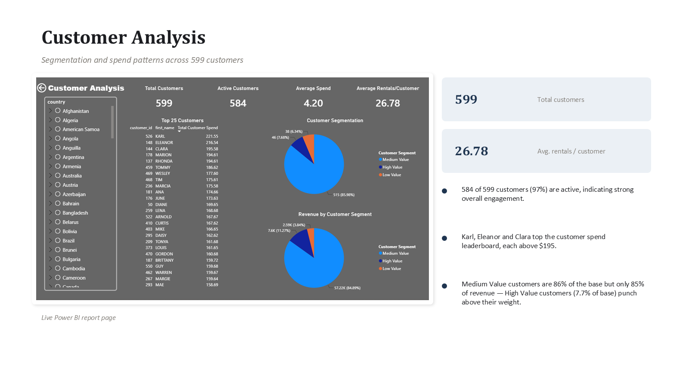
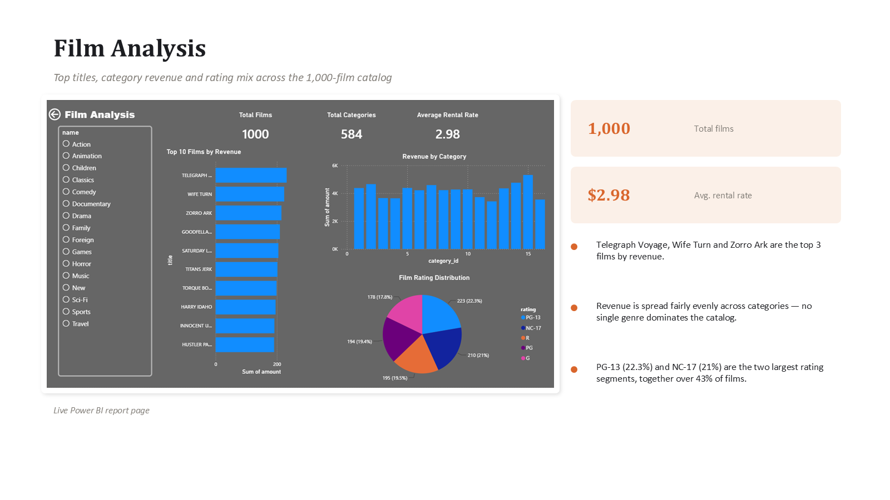
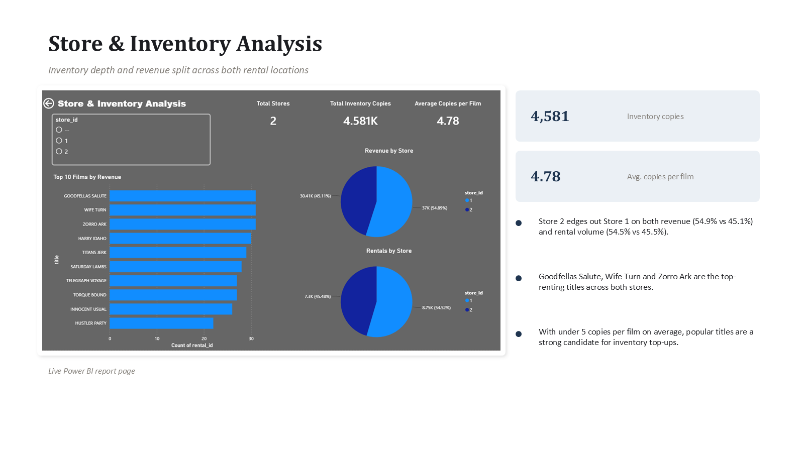
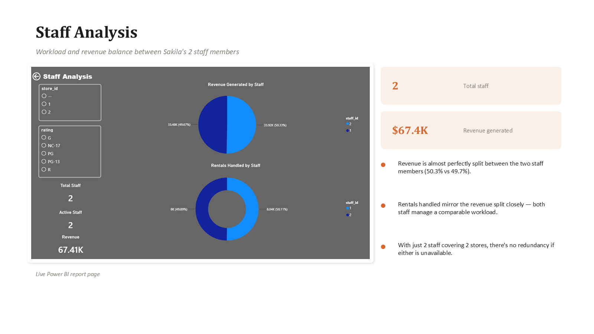
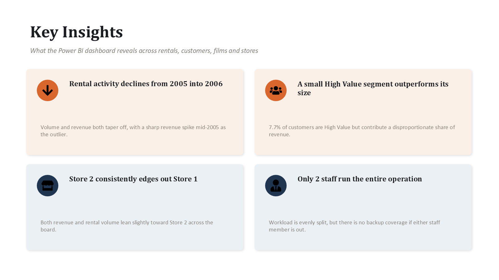
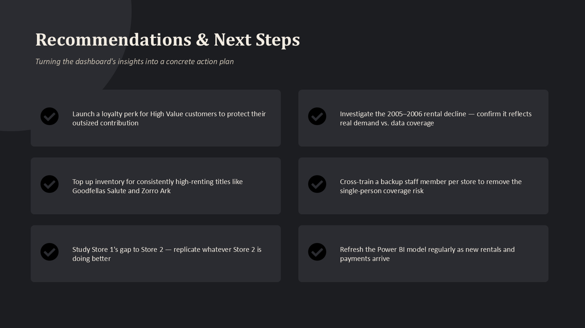

## Files

| File | What it is |
|---|---|
| `sakila_eda.sql` | SQL queries answering 15 business questions |
| `EDA.xlsx` | Excel exploratory analysis |
| `MECE.docx` | MECE breakdown of the business questions |
| `SAKILA_DASHBOARD.pbix`, `PowerBi_Sakila.pbix` | Power BI dashboard files |
| `Sakila_PowerBI_Analytics_1.pptx` | Insights deck |
| `slides/` | The deck's slides as images |
