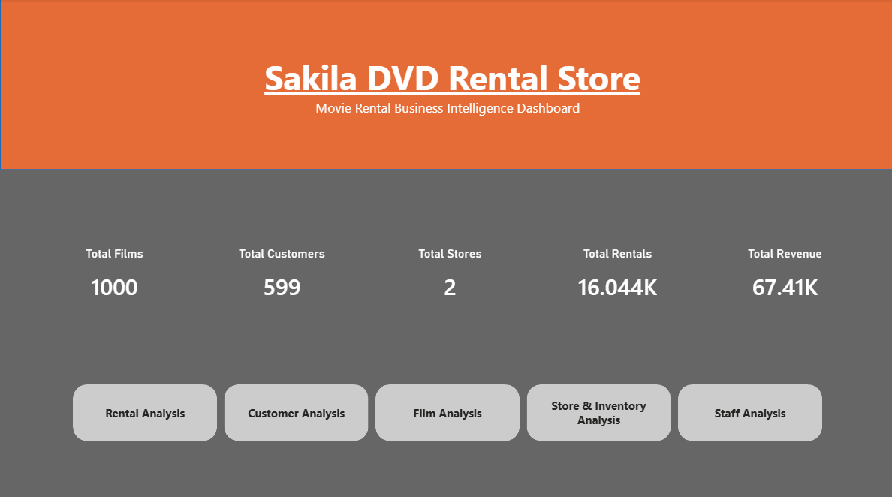
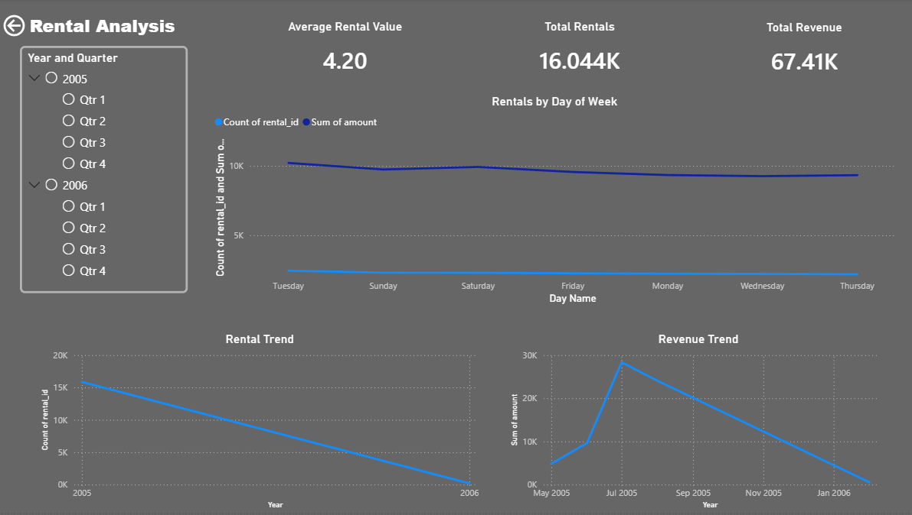
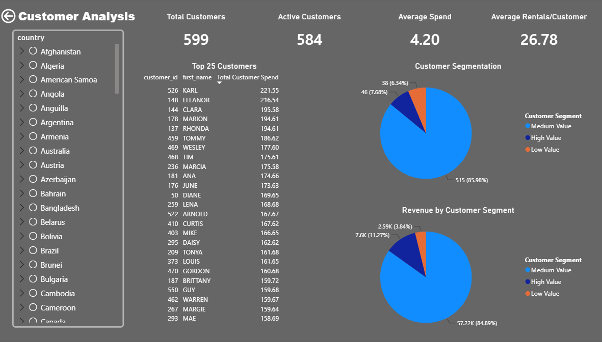
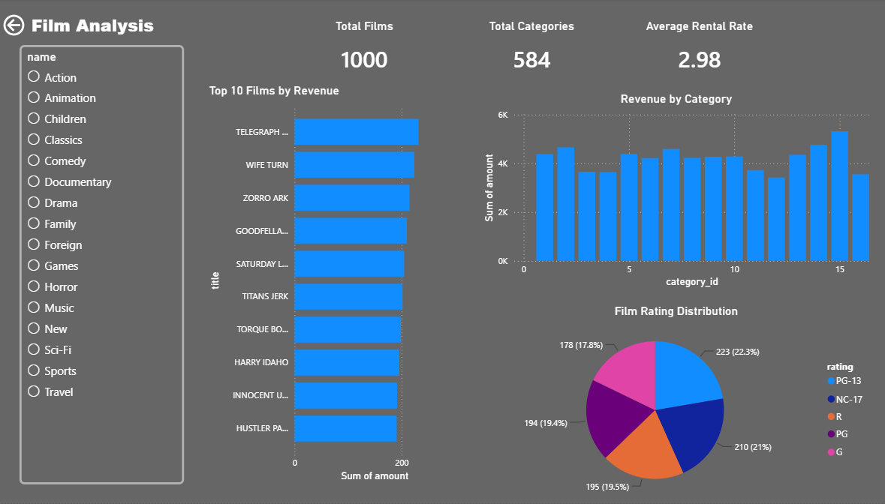
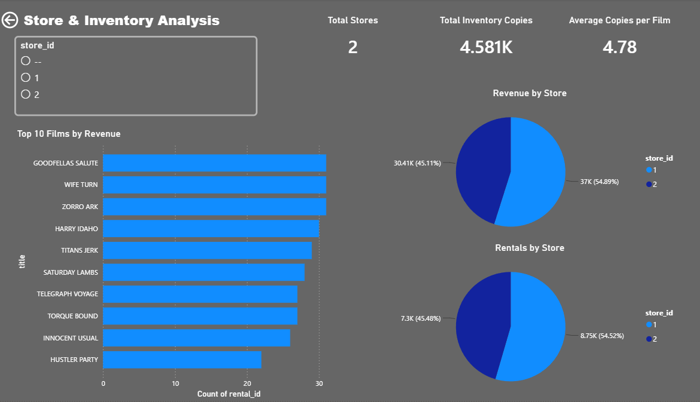
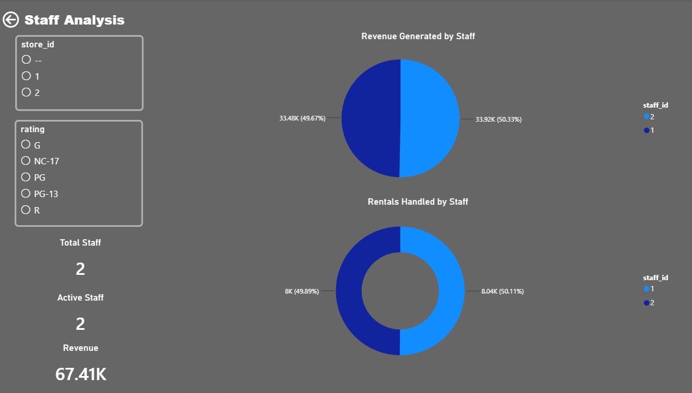

# Sakila DVD Rental Store: Business Intelligence Dashboard

An end-to-end analysis of the Sakila DVD rental database using **SQL**, **Excel** and **Power BI**.
It turns rental, customer, film, store and staff data into one connected view of the business,
then into recommendations.

**Tools:** MySQL · Excel · Power BI (DAX, data modeling)

| Films | Customers | Stores | Rentals | Revenue |
|---|---|---|---|---|
| 1,000 | 599 | 2 | 16,044 | $67.4K |

## Business problem

Sakila needs one connected view of rentals, customers and inventory across both stores, to make
decisions on inventory, staffing and customer retention.

## Approach

1. **Framed the questions** with a MECE breakdown ([MECE.docx](MECE.docx)).
2. **Explored the data in SQL**: [sakila_eda.sql](sakila_eda.sql) answers 15 business questions,
   such as new vs repeat customer behaviour, seasonal trends by store and the highest-spending customers.
3. **Explored the data in Excel** ([EDA.xlsx](EDA.xlsx)).
4. **Modeled the 16-table schema in Power BI**, with calculated columns for customer segment and revenue.
5. **Built a 6-page dashboard** ([SAKILA_DASHBOARD.pbix](SAKILA_DASHBOARD.pbix)) and an
   **insights deck** ([Sakila_PowerBI_Analytics_1.pptx](Sakila_PowerBI_Analytics_1.pptx)).

## Dashboard

### Executive overview

### Rental analysis

### Customer analysis

### Film analysis

### Store & inventory analysis

### Staff analysis

## Key insights

- **Volume, not price, drives revenue.** The average rental is $4.20, so more rentals matter more than higher prices.
- **Rental activity declines from 2005 into 2006**, with a sharp revenue spike around July 2005.
- **A small High Value segment outperforms its size.** 7.7% of customers are High Value and bring a disproportionate share of revenue.
- **97% of customers are active** (584 of 599), averaging 26.8 rentals each.
- **Store 2 edges out Store 1** on revenue (54.9% vs 45.1%) and rentals (54.5% vs 45.5%).
- **Only 2 staff run both stores.** Workload is evenly split (50.3% vs 49.7%), but there is no backup cover.
- **Inventory is thin** at under 5 copies per film on average.

## Recommendations

1. Launch a loyalty perk for High Value customers to protect their revenue.
2. Investigate the 2005–2006 decline to confirm whether it is real demand or a gap in the data.
3. Top up inventory for consistently high-renting titles such as Goodfellas Salute and Zorro Ark.
4. Cross-train a backup staff member for each store.
5. Study what Store 2 does better and apply it to Store 1.

## Files

| File | What it is |
|---|---|
| `sakila_eda.sql` | SQL queries answering 15 business questions |
| `EDA.xlsx` | Excel exploratory analysis |
| `MECE.docx` | MECE breakdown of the business questions |
| `SAKILA_DASHBOARD.pbix`, `PowerBi_Sakila.pbix` | Power BI dashboard files |
| `Sakila_PowerBI_Analytics_1.pptx` | Insights deck |
| `images/` | Dashboard screenshots |
